  
  
  

  

---

### 🚉 Station info

I'm Victor, an engineer-essayist from Guadalajara studying Computer Science at **UDG**. Every project I build is a station on a personal metro map. Each line is the person or the place it was built for.

  
  
  
  
  
  
  
  
  

### 🕒 Departures

| Line | Station | What it does | Status |
|:---:|---|---|---|
|  | [**TRL Backtesting**](https://github.com/Cracksmity/trl_project) | Open-source backtesting platform: FastAPI + React | 🟢 Full route |
|  ⇄  | [**SistemaIVR**](https://github.com/Cracksmity/SistemaIVR) | Geospatial redensification index for urban planning | 🟡 Extension in progress |
|  | [**Oráculo BDS**](https://github.com/Cracksmity/oraculo-bds-assistant) | AI oracle for Minecraft Bedrock servers over RCON | 🟢 In service |
|  | [**Speculum**](https://cracksmity.dev) | A mirror to think with: your essays are the anchor; philosophy and literature, the reflection.  Expo app + RAG backend (FastAPI · Postgres/pgvector · Claude) | 🟢 In service |
|  ⇄  | [**VibeLoader**](https://github.com/Cracksmity/vibeload) | Downloader/converter GUI on yt-dlp + ffmpeg | 🟢 In service |
|  | [**ByteHauler**](https://github.com/Cracksmity/ByteHauler) | Video compression + OBS automation | 🟢 In service |
|  ⇄  | [**MC-Barra-Salud**](https://github.com/Cracksmity/MC-Barra-Salud) | Floating health bars for Minecraft Bedrock | 🟢 In service |
|  | [**PoliCubo**](https://github.com/Cracksmity/PoliCubo) | 3D political spectrum explorer with AI chat | 🟢 In service |
|  | **AmortizaCore** | *Coming soon* | 🚧 Under construction |

  
<b>🗺️ More stations on the network</b>

   

| Line | Station | What it does | Status |
|:---:|---|---|---|
|  | [InstaLight](https://github.com/Cracksmity/InstaLight) | Compress & crop photos to Instagram ratios | 🟢 In service |
|  | [Cat Detector](https://github.com/Cracksmity/cat-image-detector) | Cat or not cat? 🐱 | 🟢 In service |
|  | [Sticker Studio](https://github.com/Cracksmity/WhatsApp-Sticker-Studio) | WhatsApp sticker maker | 🟢 In service |
|  | [Meteo ESP32](https://github.com/Cracksmity/estacion-meteorologica-esp32) | MicroPython weather station + web panel | 🏛️ Historic station |
|  | [Sisyphus](https://github.com/Cracksmity/Sisyphus) | A tool for writing deeper essays | 🏛️ Historic station |
|  | [Metaheuristics Lab](https://github.com/Cracksmity/metaheuristics-lab) | GUI to explore metaheuristic algorithms | 🟢 In service |
|  | [botAsesorCarreras](https://github.com/Cracksmity/botAsesorCarreras) | Career-advisor chatbot on Rasa 3.x | 🟢 In service |
|  | Dopamink | *Coming soon* | 🚧 Under construction |
|  | Jalisk | *Coming soon* | 🚧 Under construction |

### 🛤️ Rolling stock

  

### 📊 Ridership

  
  

<!-- Train: generated by .github/workflows/snake.yml + scripts/train.py -->

  <picture>
    <source media="(prefers-color-scheme: dark)" srcset="https://raw.githubusercontent.com/Cracksmity/cracksmity/output/github-train-dark.svg" />
    
  </picture>

  <code>LOC</code> Guadalajara, MX &nbsp;·&nbsp; <code>BUILD</code> always &nbsp;·&nbsp; <code>NEXT STOP</code> <a href="https://cracksmity.dev">cracksmity.dev</a> &nbsp;·&nbsp; 🚇 Mind the gap

